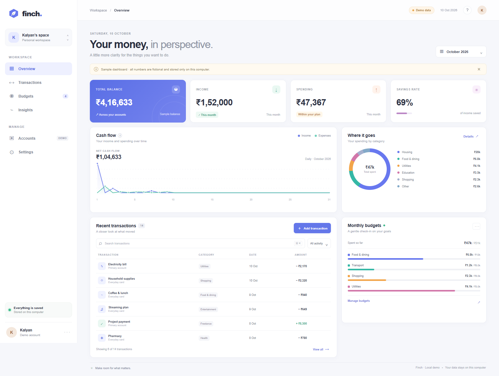

# Finch Money Dashboard

<strong>A responsive personal-finance dashboard prototype for exploring fictional INR transactions.</strong>

## Overview

Finch presents balances, monthly cash flow, category spending, editable budgets, and searchable, addable, removable transactions in a responsive dashboard.

## Preview

## Run locally

No package installation or server is needed for the browser-storage demo:

1. Clone this repository.
2. Open `index.html` in a modern browser.

The GitHub Pages version works the same way. Edits are stored in that browser's `localStorage`, so each browser has a separate demo copy.

## Data and scope

All names, balances, and transactions are fictional. The demo does not connect to a bank or collect credentials. Data stays in the current browser and is not synced to another device.

## Deploy

GitHub Actions publishes the static files to GitHub Pages on pushes to `main`. The deployment workflow is in `.github/workflows/deploy-pages.yml`.

## Project structure

- `index.html` — dashboard markup
- `styles.css` — responsive layout and theme
- `app.js` — dashboard interactions and local demo state
- `demo-data.json` — fictional sample data
- `preview-desktop.png` — desktop screenshot
